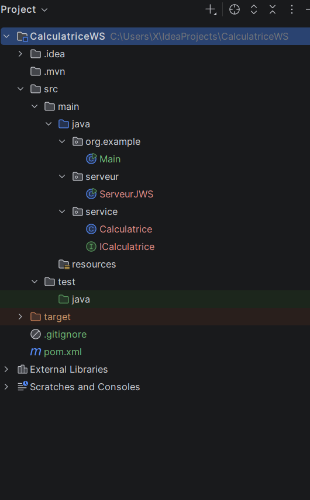
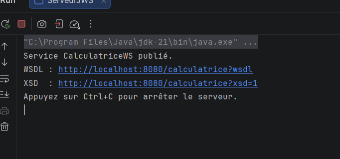
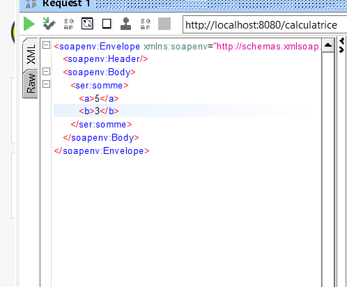
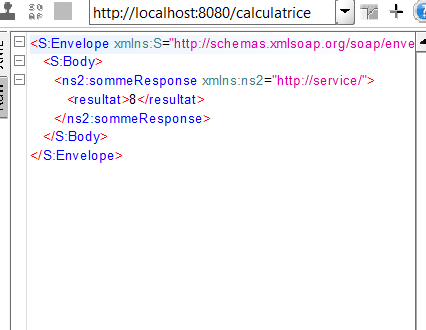

# CalculatriceWS — TP2 : Mise en œuvre de Jakarta XML Web Services
## 1. Description

`CalculatriceWS` est un service web SOAP développé en Java avec **Jakarta XML Web Services (JAX-WS)**. Il expose quatre opérations arithmétiques fondamentales : `somme`, `soustraction`, `multiplication` et `division`.

> **Note** : La gestion d'erreur de la division par zéro lève une exception de type **SOAP Fault**.

---

## 2. Prérequis

* **JDK** : 17 (ou version supérieure)
* **Build Tool** : Maven 3.8+
* **IDE** : IntelliJ IDEA
* **Client de Test** : SoapUI

---
## 3. Structure du projet

```text
CalculatriceWS
├── pom.xml
├── README.md
├── captures/
└── src/main/java
    ├── service
    │   ├── ICalculatrice.java   (contrat du service : @WebService, @WebMethod, @WebParam)
    │   └── Calculatrice.java    (classe métier / implémentation)
    └── serveur
        └── ServeurJWS.java      (publication avec Endpoint.publish)


```

## 4. Dépendances Maven

Voici les dépendances nécessaires configurées dans le fichier `pom.xml` :

| Dépendance | Rôle |
| :--- | :--- |
| `jakarta.xml.ws:jakarta.xml.ws-api` | Interfaces JAX-WS (`Endpoint`, etc.) |
| `com.sun.xml.ws:jaxws-rt` | Implémentation / moteur d'exécution du service Web |
| `jakarta.jws:jakarta.jws-api` | Annotations JAX-WS (`@WebService`, `@WebMethod`, `@WebParam`) |

## 5. Exécution

1. Ouvrez le projet dans **IntelliJ IDEA** et laissez Maven charger automatiquement l'ensemble des dépendances.
2. Lancez la classe `serveur.ServeurJWS` (exécutez sa méthode `main`).
3. Le service Web est alors publié à l'adresse suivante :  
   

## 6. Test avec SoapUI

### Étapes de test :
1. Allez dans **File → New SOAP Project**, puis saisissez l'URL du WSDL (`http://localhost:8080/calculatrice?wsdl`).
2. Ouvrez une opération (par exemple `somme`), puis double-cliquez sur **Request 1**.
3. Remplacer les `?` par des valeurs numériques, par exemple `a = 5` et `b = 3`.
4. Cliquez sur le bouton d'exécution (**▶**) et observez la réponse SOAP.

### Exemple de Requête SOAP (`somme`) :

**Réponse attendue :** `<return>8</return>`




